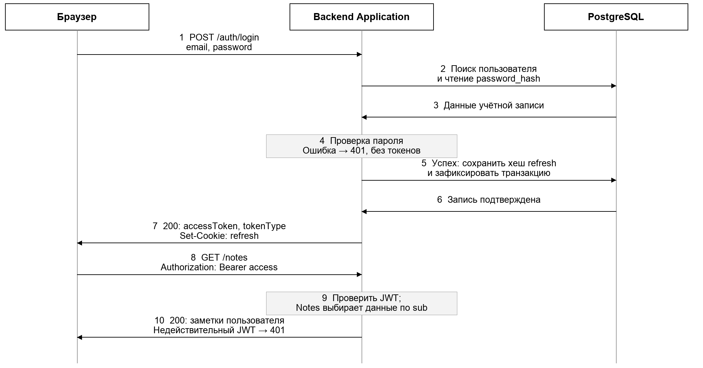
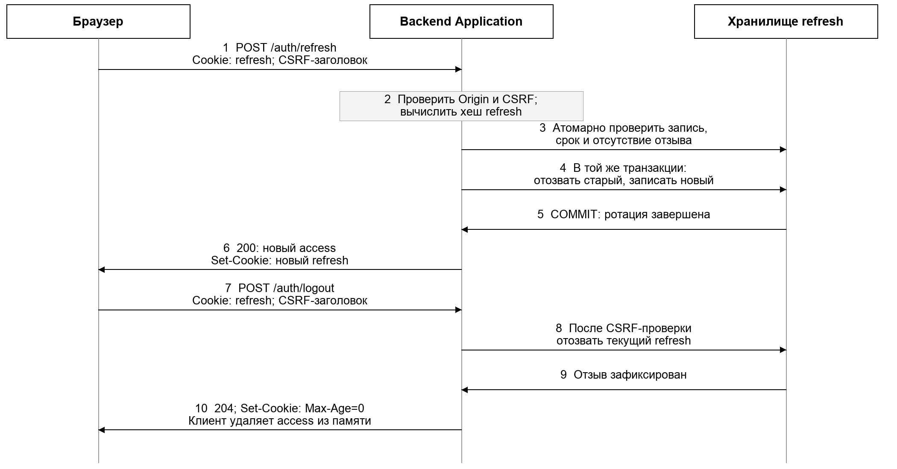

# ADR-004: Токены доступа и обновления

## Статус

Принято. Уточняет JWT-аутентификацию из [ADR-001](ADR-001.md).

## Дата

22.10.2026

## Контекст

ADR-001 выбрал JWT без серверных сессий, но не определил состав токена, срок жизни, хранение и порядок обновления. Долгоживущий токен доступа нельзя отозвать, а хранение токенов в `localStorage` делает их доступными любому внедрённому скрипту.

## Решение

1. **Access token** – подписанный JWT на 15 минут. Claims: `sub` (userId), `iat`, `exp = iat + 900`. Пароль и содержимое заметок в токен не включаются. Сервер проверяет подпись, разрешённый алгоритм и `exp`. Хранится в памяти приложения, передаётся в `Authorization: Bearer`.
2. **Refresh token** – непрозрачное случайное значение без claims, срок 30 дней. В PostgreSQL (`auth_refresh_tokens`) хранится только его хеш, пользователь, срок и признак отзыва. Браузер получает cookie `Secure; HttpOnly; SameSite=Strict; Path=/api/v1/auth`, без `Domain`.
3. **Ротация.** `POST /auth/refresh` проверяет `Origin` и CSRF-заголовок, затем в одной транзакции под `SELECT … FOR UPDATE` отзывает прежний refresh и выпускает новый. Параллельный запрос со старым токеном получает 401; клиент объединяет параллельные попытки обновления.
4. **Выход.** `POST /auth/logout` отзывает текущий refresh и удаляет cookie. Access остаётся действительным до `exp` – это осознанный компромисс короткого срока жизни.
5. Право на конкретную заметку проверяет контекст Notes по `sub`; действительный JWT не даёт доступа к чужим данным.

## Рассмотренные варианты

- Один долгоживущий JWT – отклонён: нельзя отозвать.
- Хранение токенов в `localStorage` – отклонено: доступно XSS.
- Серверные сессии – отклонены: противоречат stateless-копиям (ADR-005).

## Последствия

- Отзыв доступа занимает не более 15 минут без чёрного списка токенов.
- Нужна CSRF-защита операций `/auth/*`, поскольку cookie отправляется браузером автоматически.
- Возможное расширение: обнаружение повторного использования отозванного refresh вне короткого окна ротации с отзывом всех токенов пользователя.
