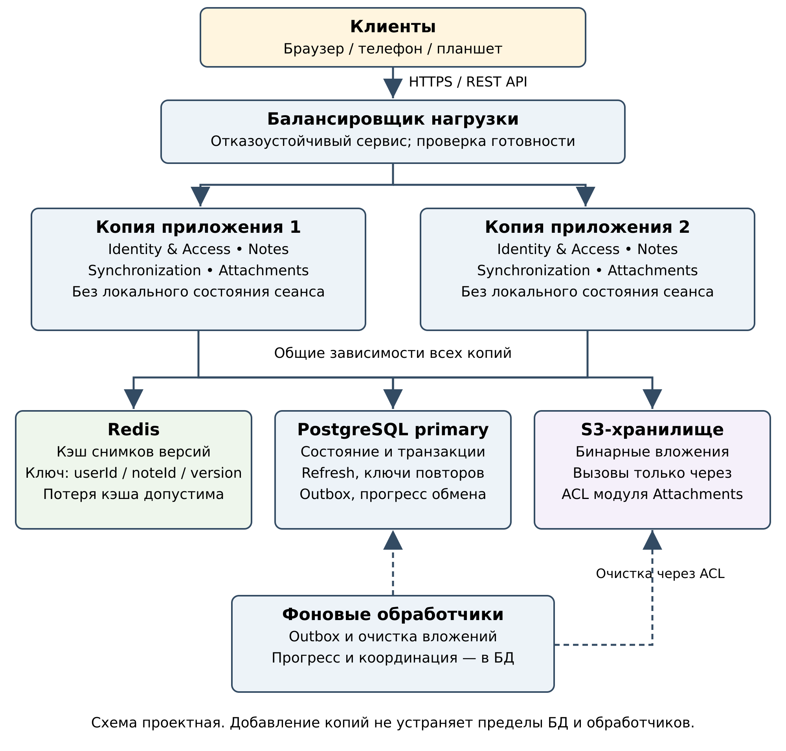

# ADR-005: Горизонтальное масштабирование

## Статус

Принято.

## Дата

25.10.2026

## Контекст

Архитектура должна ответить на вопрос «что будет, если пользователей станет в сто раз больше». Модульный монолит (ADR-001) развёртывается одной единицей, поэтому масштабируется копированием приложения целиком.

## Решение

1. Балансировщик распределяет запросы между не менее чем двумя взаимозаменяемыми копиями (round-robin или least-connections) с проверкой готовности; sticky sessions не нужны.
2. Копии не хранят состояние пользователя: refresh, ключи идемпотентности, попытки загрузки, подтверждения устройств и контрольные точки находятся в PostgreSQL. Все копии проверяют access одинаковыми настройками ключей.
3. Redis – необязательный кэш неизменяемых снимков `NoteVersion` (cache-aside). Ключ содержит userId, noteId и version; актуальная версия и права всегда проверяются по БД. Redis не используется для блокировок корректности и не хранит единственную копию данных. При недоступности Redis чтение идёт в PostgreSQL.
4. PostgreSQL – источник истины. Сначала оптимизируются запросы и индексы, ограничиваются размеры страниц и партий `/sync`, настраиваются пулы соединений с учётом общего бюджета БД.
5. Файлы вложений хранятся во внешнем S3-совместимом хранилище, в БД – метаданные.
6. Фоновые обработчики outbox делят записи через `FOR UPDATE SKIP LOCKED` с арендой задачи; обработчик ленты синхронизации сериализован `pg_advisory_xact_lock`.
7. Порядок роста: ресурсы и оптимизация БД, копии за балансировщиком, кэш по измерениям, реплики чтения, шардирование по userId только при подтверждённом пределе. Реплики не используются для проверки владельца, refresh и версий.

## Проверка

Нагрузочные испытания не выполнялись; план проверки:

| Проверка | Ожидаемый результат |
|---|---|
| Профиль на 1, 2 и 4 копиях | измерены RPS, p95/p99, ошибки, загрузка БД; найден предел |
| Правка одной версии через две копии | одна запись успешна, другая получает конфликт |
| Повтор команды и refresh на разных копиях | один эффект; refresh заменяется один раз |
| Остановка копии после COMMIT до ответа | повтор с тем же ключом возвращает сохранённый результат |
| Отключение Redis | данные читаются из БД с контролем нагрузки |
| Отказ обработчика, S3 или primary | прогресс не теряется, успех не подтверждается без COMMIT |

## Последствия

- Рост числа копий не меняет гарантий корректности (ADR-003).
- Узкие места: БД и обработчик ленты; их нужно наблюдать (возраст старейшей записи outbox, ожидания блокировок, число соединений).
- Шардирование потребует отдельного проекта маршрутизации и изменения протокола курсоров.
