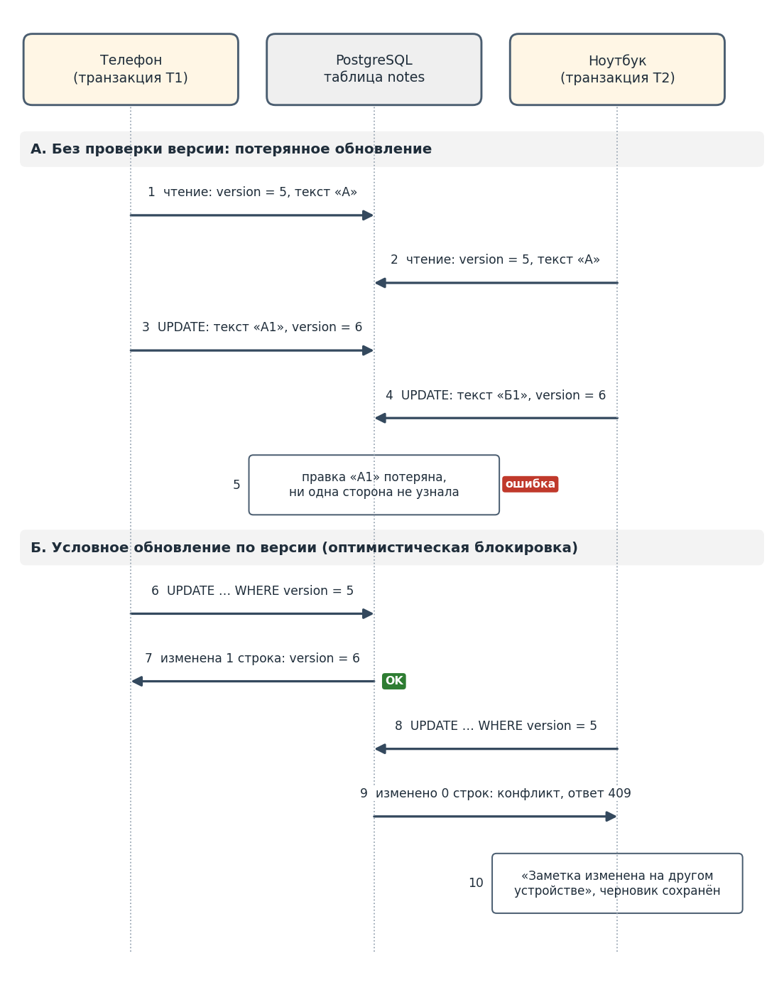
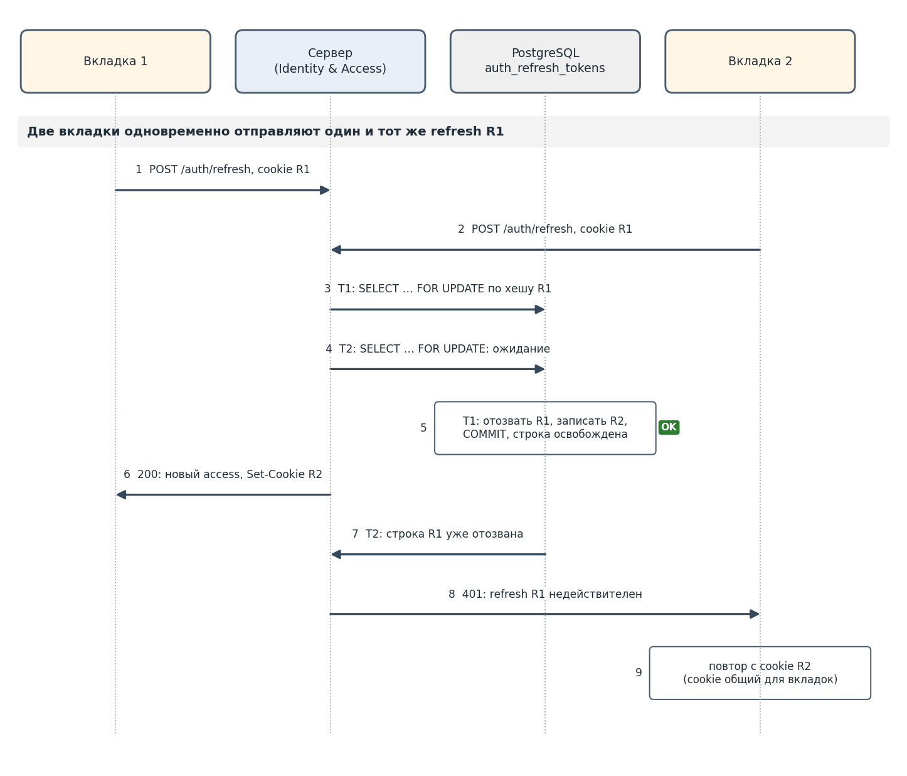

# Состояния гонки и блокировки (ЛР4)

Состояние гонки возникает, когда результат зависит от порядка выполнения параллельных операций. В Notes Service параллельные операции появляются из четырёх источников: несколько устройств одного пользователя, несколько вкладок браузера, повторы запросов после таймаута и несколько копий серверного приложения с фоновыми обработчиками. Блокировка в памяти одной копии не видна другим, поэтому вся координация выполняется в PostgreSQL.

Решение зафиксировано в [ADR-003](../architecture/ADR-003-concurrency-control.md).

## Уровень изоляции и принцип выбора

Все транзакции выполняются на уровне READ COMMITTED (по умолчанию в PostgreSQL). MVCC позволяет чтению не блокировать запись. Уровень сам по себе не защищает от потерянного обновления, а SERIALIZABLE «на всякий случай» увеличивает число откатов. Поэтому для каждой точки гонки выбран явный механизм по правилу: **частота конфликтов × цена ошибки**.

| Механизм | Принцип | Когда применять |
|---|---|---|
| Оптимистическая блокировка | `UPDATE … WHERE version = ожидаемая`; 0 строк – конфликт | конфликты редки, повтор или согласование допустимы |
| Пессимистическая блокировка | `SELECT … FOR UPDATE` до конца короткой транзакции | конфликт вероятен, ошибка недопустима |
| Ограничение уникальности | `UNIQUE` + `INSERT … ON CONFLICT` | ключ существует не более одного раза |
| Рекомендательная блокировка | `pg_advisory_xact_lock` | единственный исполнитель фоновой задачи |

## Точка 1: одновременное редактирование заметки

Телефон и ноутбук открыли версию 5 и оба сохраняют изменения. Без защиты вторая запись перезапишет первую – дефект R6, R7.



Выбрана **оптимистическая блокировка**: конфликты редки, удерживать блокировку на время редактирования (и тем более работы без связи) невозможно, а правку второго устройства достаточно обнаружить и вернуть пользователю.

```sql
UPDATE notes
   SET title = $3, content = $4, version = version + 1, updated_at = now()
 WHERE id = $1 AND user_id = $2 AND version = $5 AND NOT is_deleted
RETURNING version;
```

При 0 строк повторное чтение по `id` и `user_id` различает: заметки нет или она чужая – 404 (защита от BOLA), заметка удалена – отказ по N4, версия устарела – `409 VERSION_CONFLICT` с текущей версией. Снимок в `note_versions` и событие в `outbox` пишутся в той же транзакции (N5). Клиент не повторяет конфликтующую правку автоматически.

## Точка 2: ротация токена обновления

Две вкладки одновременно отправляют `POST /auth/refresh` с одним cookie R1. Если обе прочитают R1 до отзыва, появятся две цепочки токенов.



Выбрана **пессимистическая блокировка строки**: конфликт вероятен, цена ошибки – безопасность, транзакция длится миллисекунды.

```sql
BEGIN;
SELECT id, user_id FROM auth_refresh_tokens
 WHERE token_hash = $1 AND revoked_at IS NULL AND expires_at > now()
   FOR UPDATE;
UPDATE auth_refresh_tokens SET revoked_at = now() WHERE id = $2;
INSERT INTO auth_refresh_tokens (id, user_id, token_hash, expires_at)
VALUES ($3, $4, $5, now() + interval '30 days');
COMMIT;
```

Вторая транзакция ждёт строку, после фиксации первой перепроверяет условие, не находит действующей записи и получает 401; вкладка повторяет запрос с общим cookie R2. Клиент объединяет параллельные попытки обновления, задаётся `lock_timeout`.

## Точка 3: повторная отправка команды

Ответ потерялся по таймауту, клиент повторил запрос. Для POST это дубликат заметки, для PATCH – ложный конфликт 409.

Выбран **ключ идемпотентности** с ограничением уникальности:

```sql
CREATE TABLE idempotency_keys (
  user_id      uuid        NOT NULL,
  key          uuid        NOT NULL,
  request_hash text        NOT NULL,
  response     jsonb,
  created_at   timestamptz NOT NULL DEFAULT now(),
  PRIMARY KEY (user_id, key)
);
```

Вставка ключа `INSERT … ON CONFLICT DO NOTHING` – первая команда бизнес-транзакции, ответ записывается в ту же строку до фиксации. Второй одновременный повтор ждёт на уникальном индексе и после фиксации первого возвращает сохранённый ответ. Тот же ключ с другим телом – 422. Ключи старше 24 часов удаляются.

## Дополнительные точки гонки

| Точка | Риск без защиты | Механизм | Связь с моделью |
|---|---|---|---|
| Регистрация с одним e-mail | две учётные записи | `UNIQUE (email)`, вторая вставка – 409 | Identity & Access |
| Подтверждение партии синхронизации | контрольная точка откатится назад | условное обновление: курсор растёт монотонно | S3, S4 |
| Повторная регистрация события | двойная доставка | `UNIQUE (device_id, event_id)` | S2 |
| Обработка outbox несколькими копиями | событие отправлено дважды | `FOR UPDATE SKIP LOCKED` | outbox |
| Запись в ленту изменений | позиции не совпадут с порядком фиксации | обработчик ленты под `pg_advisory_xact_lock` | SyncSession |
| Запоздалый ответ хранилища | старая попытка меняет состояние | проверка `attemptId` текущей попытки | A4 |
| Прикрепление к удаляемой заметке | файл у удалённой заметки | без межагрегатной блокировки: повторная проверка и очистка по NoteDeleted | A1, A3 |

## Правила против взаимоблокировок

- транзакции короткие и без сетевых вызовов: хранилище, уведомления и доставка событий – вне транзакции, через outbox;
- несколько строк блокируются в одном порядке (по возрастанию идентификатора);
- для блокирующих операций задаются `lock_timeout` и `statement_timeout`;
- условия опираются на индексы, поэтому блокируется одна строка, а не диапазон.

## Итог

| Точка | Частота конфликта | Цена ошибки | Механизм | Дефект или инвариант |
|---|---|---|---|---|
| Правка заметки | низкая | высокая, но достаточно обнаружения | оптимистическая по версии | R6, R7; N2, N4, N5 |
| Ротация refresh | высокая | безопасность | `SELECT … FOR UPDATE` | ADR-004 |
| Повтор команды | средняя | дубликат или ложный конфликт | Idempotency-Key, `UNIQUE (user_id, key)` | R3 |
