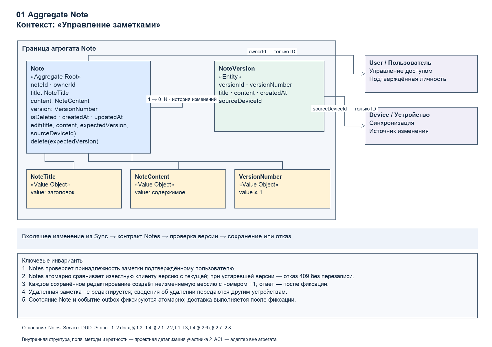
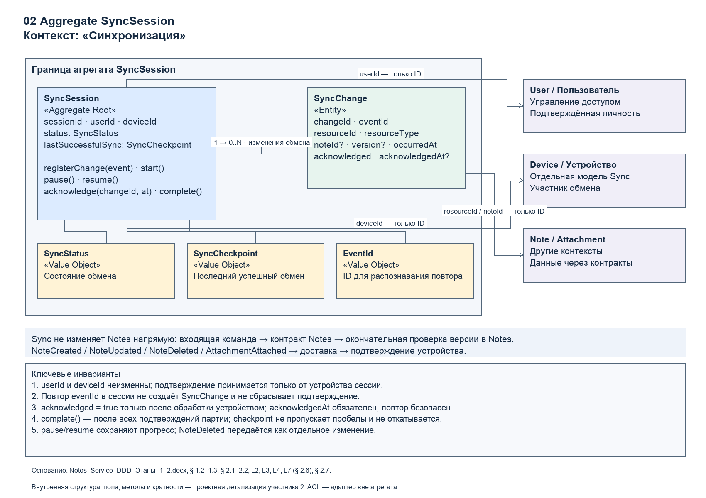
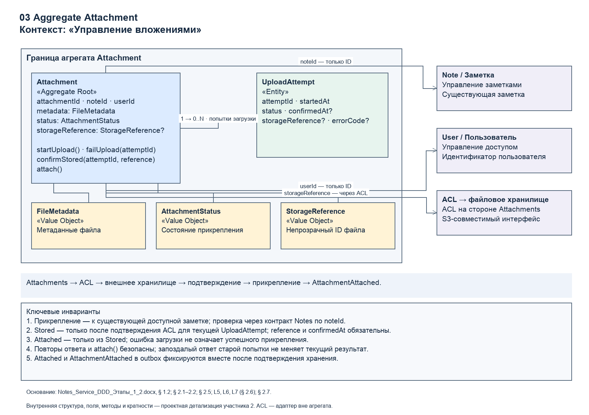

# Агрегаты и инварианты

Каждый корень защищает собственное состояние и принимает доменные операции. Объекты-значения неизменяемы. Внешние модели связаны по идентификаторам и не входят в транзакционную границу другого агрегата: одна транзакция изменяет один агрегат.

## Note

| Элемент | Тип | Поля и назначение |
|---|---|---|
| Note | Aggregate Root | noteId, ownerId, title, content, version, isDeleted, createdAt, updatedAt |
| NoteVersion | Entity | versionId, versionNumber, title, content, createdAt, sourceDeviceId; неизменяемый снимок |
| NoteTitle, NoteContent | Value Object | значения заголовка и содержимого |
| VersionNumber | Value Object | целое ≥ 1 |
| ownerId, sourceDeviceId | связи по ID | пользователь (Identity & Access), устройство (Synchronization) |

Операции корня: `Note.create()`, `edit(title, content, expectedVersion, sourceDeviceId)`, `delete(expectedVersion)`.

| № | Инвариант |
|---|---|
| N1 | Изменение разрешено только после проверки принадлежности заметки пользователю; userId берётся из проверенного контекста аутентификации |
| N2 | expectedVersion совпадает с текущей версией; проверка и запись атомарны – отдельная проверка перед безусловным UPDATE не защищает от гонки |
| N3 | Начальная версия равна 1; каждое сохранённое редактирование увеличивает её на единицу и создаёт один неизменяемый снимок |
| N4 | Мягко удалённая заметка не редактируется как активная; удаление тоже требует актуальной версии |
| N5 | Новое состояние, снимок и запись события в outbox фиксируются одной транзакцией |

## SyncSession

Корень управляет обменом одного пользователя с одним устройством. Внутри – сущность SyncChange и объекты-значения SyncStatus, SyncCheckpoint, EventId. Сессия хранит сведения о доставке, но не включает агрегаты заметок и вложений.

| № | Инвариант |
|---|---|
| S1 | userId и deviceId сессии неизменны |
| S2 | Повторная регистрация eventId не создаёт вторую запись и не сбрасывает полученное подтверждение |
| S3 | Подтверждение означает успешную обработку изменения устройством; повтор подтверждения сохраняет первоначальное время |
| S4 | Партия завершается после обработки всех изменений; контрольная точка не убывает и не перескакивает через неподтверждённые записи |
| S5 | Пауза сохраняет состав партии и подтверждения; удаление заметки передаётся явным изменением |

HTTP-ответ не означает, что устройство сохранило изменения: при обрыве до подтверждения допускается повторная доставка.

## Attachment

| Элемент | Тип | Поля и назначение |
|---|---|---|
| Attachment | Aggregate Root | attachmentId, noteId, userId, metadata, status, storageReference? |
| UploadAttempt | Entity | attemptId, startedAt, status (Started, Failed, Confirmed), confirmedAt?, storageReference?, errorCode? |
| FileMetadata | Value Object | fileName, mimeType, sizeBytes |
| AttachmentStatus | Value Object | Pending, Uploading, Failed, Stored, Attached |
| StorageReference | Value Object | непрозрачный идентификатор файла; ключ объекта скрыт за ACL |

Операции корня: `startUpload()`, `failUpload(attemptId)`, `confirmStored(attemptId, reference)`, `attach()`.

| № | Инвариант |
|---|---|
| A1 | Вложение прикрепляется к существующей заметке, доступной пользователю; это межконтекстное предусловие, проверяемое через контракт Notes (L5) |
| A2 | Подтверждение хранения относится к известной текущей попытке и сохраняется со ссылкой на файл |
| A3 | Прикрепить можно только подтверждённо сохранённый файл с действительной ссылкой |
| A4 | Повторные ответы и команды не создают дубликатов; запоздалый ответ заменённой или неуспешной попытки не меняет состояние |
| A5 | Прикрепление и событие AttachmentAttached фиксируются вместе; до фиксации вложение не объявляется доступным |

Проверка заметки перед прикреплением не делает два агрегата атомарными: удаление может произойти сразу после проверки. Поэтому событие NoteDeleted (L8) и периодическая сверка находят и очищают вложения удалённых заметок.

## Связь с дефектами ЛР1

| Дефект | Агрегаты и правила |
|---|---|
| R3, R6 – потеря и перезапись изменений | Note: N2, N3, N5 |
| R4 – потеря заметок | Note: N3, N4 (история и мягкое удаление) |
| R2, R7 – задержки обмена | SyncSession: S2–S5 |
| R9 – сканы не появляются | Attachment: A2–A5; SyncSession: S2–S4 |
| R1, R10 – недоступность после сбоя | Note и SyncSession: повторное получение сохранённых данных |
