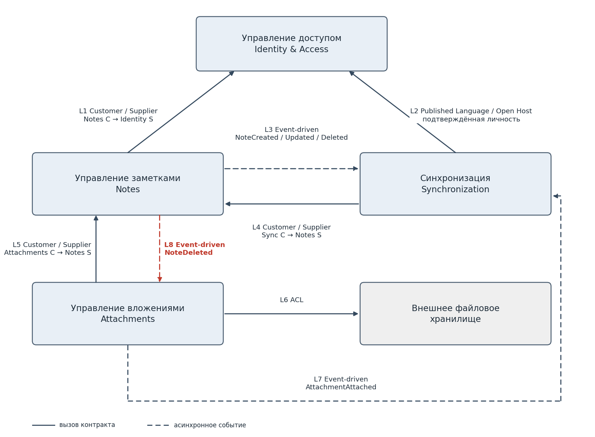

# Карта ограниченных контекстов

Четыре контекста сохраняются внутри модульного монолита: контекст задаёт смысл данных и правила, но не требует отдельного сервиса. Общая база PostgreSQL допустима, однако общая база и внешние ключи не дают модулю права изменять чужую модель в обход её операций.

## Ответственность

| Контекст | Модуль | Ответственность | Ключевые понятия |
|---|---|---|---|
| Управление доступом | Identity & Access | Идентификация, вход, жизненный цикл учётной записи и токенов; подтверждённая личность пользователя | пользователь, учётная запись, войти |
| Управление заметками | Notes | Содержимое, создание, сохранение, открытие и удаление заметок; история; окончательная проверка версии и принадлежности | заметка, версия, история, конфликт изменений |
| Синхронизация | Synchronization | Передача и получение изменений, прогресс и возобновление обмена, учёт последней успешной синхронизации | устройство, синхронизировать, последняя синхронизация |
| Управление вложениями | Attachments | Прикрепление и получение файлов, метаданные, подтверждение хранения, адаптация внешнего хранилища | вложение, прикрепить файл, открыть вложение |

## Правила границ

- Identity & Access подтверждает личность, а Notes проверяет право пользователя на конкретную заметку. Действительный токен не даёт доступа к чужой заметке.
- Synchronization не пишет в данные Notes: входящие изменения передаются через контракт Notes, где проверяется известная клиенту версия.
- Attachments владеет файлами и метаданными, Notes – содержимым заметок. Связи между моделями передаются по идентификаторам.
- Универсальный контекст «Система» не вводится.

## Контракты взаимодействия

| Связь | Роли и паттерн | Передаваемые сведения и правило |
|---|---|---|
| L1 Notes – Identity & Access | Customer / Supplier | Подтверждённый идентификатор пользователя; принадлежность заметки проверяет Notes |
| L2 Synchronization – Identity & Access | Published Language / Open Host | Тот же формат подтверждённой личности; пароль и модель учётной записи не передаются |
| L3 Notes – Synchronization | Event-driven + Published Language | NoteCreated, NoteUpdated, NoteDeleted: eventId, noteId, userId, version, occurredAt |
| L4 Synchronization – Notes | Customer / Supplier | Получение сохранённой версии и передача входящего изменения с номером версии; решение принимает Notes |
| L5 Attachments – Notes | Customer / Supplier | Проверка существования, активности заметки и доступа по noteId и userId |
| L6 Attachments – внешнее хранилище | ACL в Attachments | Перевод операций и ошибок S3-совместимого сервиса в язык вложений; ключи объектов скрыты |
| L7 Attachments – Synchronization | Event-driven + Published Language | AttachmentAttached: eventId, attachmentId, noteId, userId, occurredAt |
| L8 Notes – Attachments | Event-driven + Published Language | NoteDeleted запускает сверку и очистку вложений; повторная обработка идемпотентна |

## Доставка событий и согласованность

События обозначают свершившиеся факты и публикуются только после сохранения. Изменение агрегата и запись события фиксируются одной транзакцией (транзакционный outbox), доставка выполняется отдельно. Повторы распознаются по eventId; получатели не изменяют данные издателя. Задержка между сохранением и появлением на другом устройстве допустима, недоступность подписчика не отменяет сохранённую заметку.

`GET /sync?since` сохраняется как контракт версии 1. Для надёжного обмена введено расширение с непрозрачным курсором (позицией в упорядоченной ленте изменений) и явным подтверждением обработки. Брокер сообщений и WebSocket не требуются.

## Привязка отзывов

| Отзыв | Симптом | Контекст | Мера |
|---|---|---|---|
| R1 | заметки не открываются | Notes; Sync | повторное получение сохранённой заметки |
| R2 | синхронизация приостановлена | Sync | учёт прогресса и возобновление; клиент не блокирует редактирование |
| R3 | потеря несохранённого | Notes | подтверждение только после фиксации; локальный черновик |
| R4 | потеря заметок за годы | Notes | история версий и мягкое удаление; резервирование отдельно |
| R5 | медленный PDF | Attachments | файл отдельно от заметки, отложенная загрузка |
| R6 | пропадают последние изменения | Notes; Sync | атомарная проверка версии, 409 без перезаписи |
| R7 | задержка телефон – iPad | Sync; Notes | передача изменений после последнего обмена, видимый прогресс |
| R8 | зависания при редактировании | Notes; Sync | редактирование и фиксация отделены от фонового обмена |
| R9 | сканы не появляются | Sync; Attachments | подтверждение хранения, AttachmentAttached, повтор доставки |
| R10 | заметки появились не сразу после обновления | Notes; Sync | повторное получение серверной коллекции |
