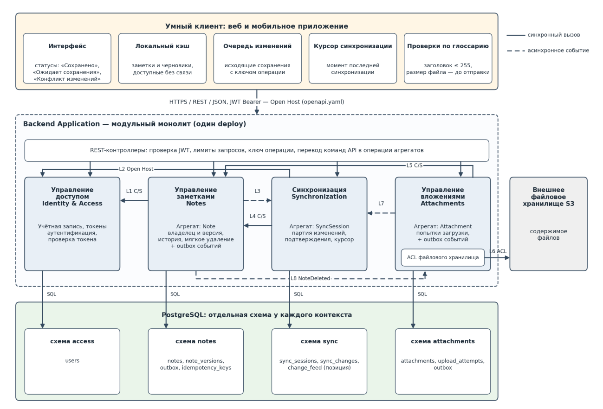
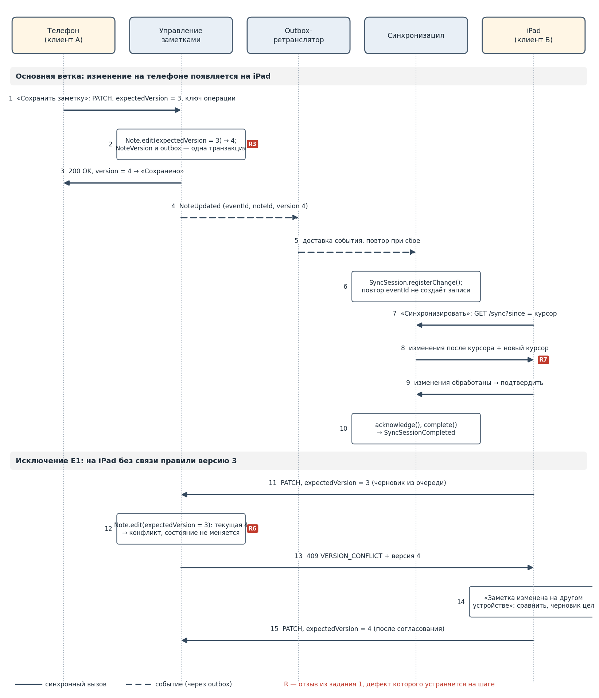
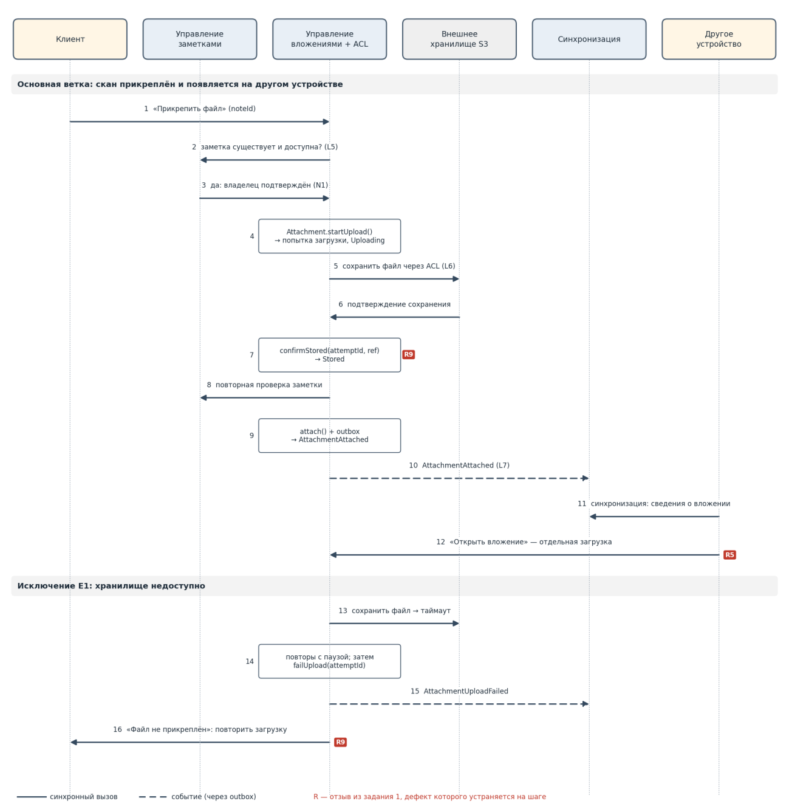

# Доменные сценарии и события

## Сценарии

| Сценарий | Цель | Ключевые правила |
|---|---|---|
| С1 Сохранить изменения заметки | Статус «Сохранено» означает фиксацию на сервере; правка с другого устройства не перезаписывает изменения незаметно (R3, R6, R7, R8) | N1, N2, N3, N5; при устаревшей версии – 409 и согласование, черновик сохраняется |
| С2 Синхронизировать устройство | Изменения доставляются после последнего успешного обмена, прогресс не теряется при обрыве (R2, R7, R10) | S1–S5; курсор и подтверждения обработки |
| С3 Прикрепить файл к заметке | Файл объявляется прикреплённым только после подтверждения хранения (R5, R9) | A1–A5; повтор загрузки, сверка и очистка |
| С4 Удалить заметку | Удалённая заметка исчезает со всех устройств и не «воскресает» | N4; NoteDeleted обрабатывают Synchronization и Attachments независимо |

Всего описаны 4 основные ветки, 8 альтернатив и 15 исключений; для каждого исключения определены обратная связь пользователю и путь восстановления.

## Схема компонентов

## Карта потока: правка заметки на двух устройствах

## Карта потока: прикрепление скана

## Каталог доменных событий

Команда запрашивает действие и может быть отклонена; событие описывает уже состоявшийся факт.

| Событие | Когда возникает | Получатель или реакция |
|---|---|---|
| NoteCreated | Зафиксирована новая заметка | Synchronization регистрирует изменение |
| NoteUpdated | Сохранено редактирование | Synchronization доставляет новую версию |
| NoteDeleted | Зафиксировано мягкое удаление | Synchronization передаёт удаление; Attachments выполняет сверку и очистку |
| AttachmentAttached | Подтверждено хранение и зафиксировано прикрепление | Synchronization передаёт сведения о вложении |
| AttachmentUploadFailed | Загрузка не подтверждена после повторов | Прикладной слой сообщает о неуспехе; очистка |
| SyncSessionPaused | Обмен прерван до завершения | Прогресс сохраняется |
| SyncSessionCompleted | Подтверждены все изменения партии | Сообщение об успешной синхронизации |

События заметок содержат eventId, noteId, userId, version, occurredAt; AttachmentAttached – eventId, attachmentId, noteId, userId, occurredAt. Бинарный файл в событие не включается.

Цепочка редактирования: команда устройства, Note.edit с expectedVersion, фиксация заметки, снимка и outbox, NoteUpdated, регистрация SyncChange, доставка, подтверждение устройства. При конфликте версии цепочка останавливается в Notes, и NoteUpdated не возникает.
